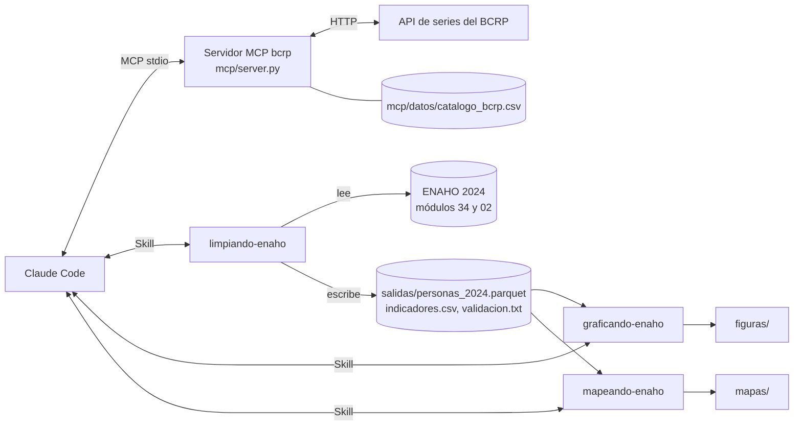
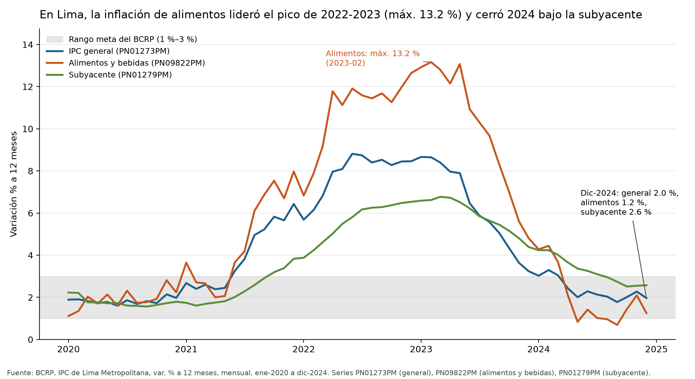
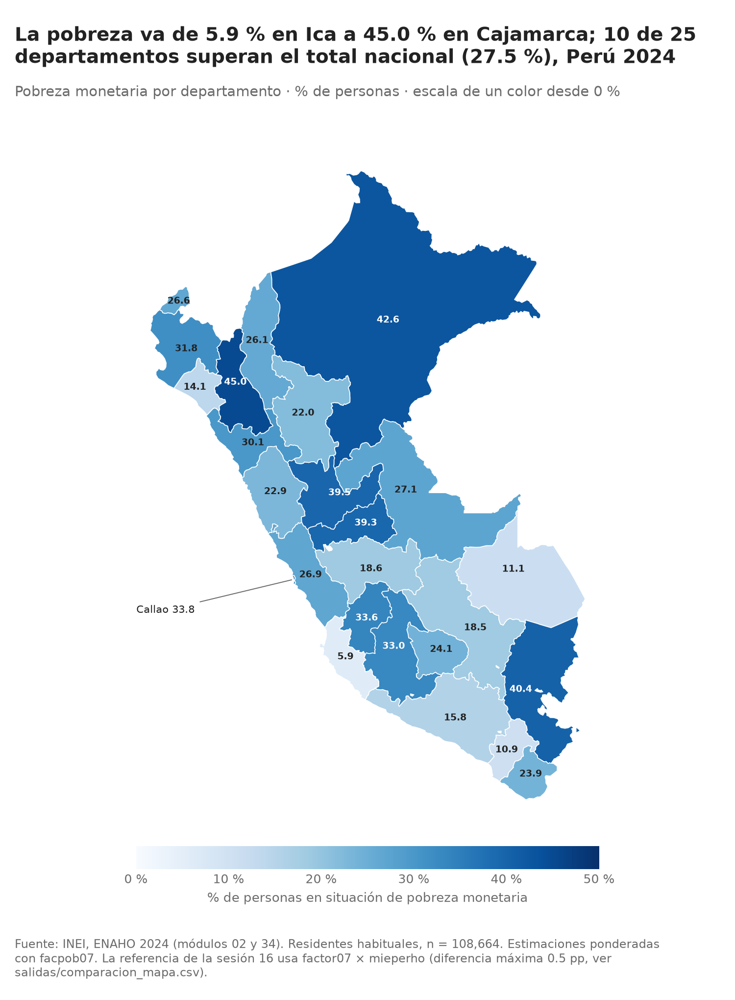

# Agente de investigación socioeconómica: MCP del BCRP, Skills de la ENAHO y evaluación

Tarea 4 de Python Intermedio. Claude Code consulta series oficiales del BCRP mediante un servidor MCP propio, procesa
la ENAHO 2024 del INEI con tres Skills y produce gráficos, un mapa y un informe verificable.

## Resultados clave de validación

| Comprobación | Resultado |
|---|---|
| Pobreza monetaria nacional 2024, sumaria (`factor07 × mieperho`) | **27.58 %** (referencia INEI 27.6 %) |
| Pobreza monetaria nacional 2024, personas (`facpob07`) | **27.53 %** (referencia INEI 27.6 %) |
| Residentes habituales (módulo 02) | **108,664** |
| Departamentos en el mapa | **25 / 25** (Lima y Callao separados) |
| Pruebas del servidor MCP (`uv run pytest`) | **10 passed** |
| Evaluación A (sin MCP ni Skills) frente a B (con ellos) | **0.5 / 10 frente a 9 / 10**, ver [`evaluacion/comparacion.md`](evaluacion/comparacion.md) |

Detalle de la validación de la ENAHO: [`salidas/validacion.txt`](salidas/validacion.txt).

## 1. Objetivo

Comprobar si un agente puede responder preguntas socioeconómicas del Perú con cifras verificables, usando herramientas
especializadas (un servidor MCP y Skills) en lugar de su memoria. El proyecto tiene cuatro partes:

1. Servidor MCP del BCRP (`mcp/server.py`).
2. Tres Skills para limpiar, graficar y mapear la ENAHO (`.claude/skills/`).
3. Una ejecución integrada con una pregunta de investigación que combina las dos fuentes (`informes/`).
4. Un experimento que compara las mismas 10 preguntas con y sin esos componentes (`evaluacion/`).

## 2. Arquitectura



Las Skills encadenan sus salidas: `graficando-enaho` y `mapeando-enaho` leen la base que deja `limpiando-enaho`. Los
scripts de `scripts/` unen las dos fuentes: `descargar_bcrp.py` llama a la herramienta `serie` del servidor en memoria
con `fastmcp.Client`.

## 3. Herramientas, recurso y prompt del servidor MCP

| Elemento | Qué hace |
|---|---|
| `buscar_series(texto, frecuencia, limite)` | Busca series en el catálogo oficial por palabras clave |
| `serie(codigo, desde, hasta)` | Descarga los datos de una serie para un periodo |
| `resumen(codigo, desde, hasta)` | Calcula variaciones, promedio, máximo y mínimo, con su periodo |
| `comparar_periodos(codigo, desde_a, hasta_a, desde_b, hasta_b)` | Herramienta propia: compara el promedio de dos tramos de una serie |
| Recurso `bcrp://serie/{codigo}` | Ficha de una serie: nombre, frecuencia, inicio y última actualización (no descarga datos) |
| Prompt `informe(tema)` | Guía para redactar un informe breve usando solo las herramientas del servidor y citando serie, periodo y fuente |

Las cuatro herramientas son de solo lectura.

## 4. Skills

| Skill | Qué hace | Salidas |
|---|---|---|
| `limpiando-enaho` | Limpia y une los módulos 34 y 02, deja los residentes habituales con pobreza, área, departamento y factor de expansión, y valida el resultado | `salidas/personas_2024.parquet`, `indicadores.csv`, `validacion.txt` |
| `graficando-enaho` | Gráficos de barras ponderados de pobreza: urbano y rural, por sexo (o sexo del jefe de hogar) y por departamento | `figuras/*.png` (200 dpi) |
| `mapeando-enaho` | Mapa coroplético de pobreza por departamento (25 unidades, Lima y Callao separados) | `mapas/pobreza_departamento_2024.png` |

Cada Skill vive en `.claude/skills/<nombre>/` con su `SKILL.md` y sus scripts.

## 5. Fuentes y descarga de datos

| Fuente | Dato | Enlace |
|---|---|---|
| INEI | ENAHO 2024, módulo 34 (sumaria) | https://proyectos.inei.gob.pe/iinei/srienaho/descarga/STATA/966-Modulo34.zip |
| INEI | ENAHO 2024, módulo 02 (miembros del hogar) | https://proyectos.inei.gob.pe/iinei/srienaho/descarga/STATA/966-Modulo02.zip |
| Repositorio del curso | Límites departamentales (GeoJSON) | https://raw.githubusercontent.com/d2cml-ai/Data-Science-Python/main/sessions/06-geoespacial/lab/Data/peru_departamental_simple.geojson |
| BCRP | Series estadísticas (API y catálogo) | https://estadisticas.bcrp.gob.pe/estadisticas/series/ |
| INEI | Evolución de la Pobreza Monetaria 2015-2024 (cifras de referencia de la evaluación) | informe técnico del INEI, páginas 65 y 72 |

Los dos `.zip` se guardan **sin extraer** en `datos/`. La carpeta `datos/` no se versiona (está en `.gitignore`), así que
hay que descargarlos para reproducir. El GeoJSON va en `referencias/`.

## 6. Instalación con `uv`

```bash
# 1. Instalar uv: https://docs.astral.sh/uv/
git clone https://github.com/ValMur123/python_intermedio.git
cd python_intermedio/tarea_4
uv sync            # crea .venv e instala las dependencias de pyproject.toml (Python >= 3.11)
```

Dependencias principales: `fastmcp`, `httpx`, `pandas`, `pyarrow`, `geopandas`, `matplotlib`; `pytest` en el grupo de
desarrollo.

## 7. Conectar el MCP a Claude Code

Desde `tarea_4/`:

```bash
claude mcp add --scope project bcrp -- uv run mcp/server.py
claude mcp list        # debe mostrar bcrp conectado
```

Esto escribe `.mcp.json` en la raíz del proyecto. Dentro de Claude Code, `/mcp` muestra el servidor y sus herramientas.
Para el experimento se usa `evaluacion/mcp_bcrp.json`, que declara solo `bcrp` (el `.mcp.json` del proyecto incluye
también un servidor `fetch`, que daría acceso a la web).

## 8. Comandos para reproducir

Todos desde `tarea_4/`:

```bash
uv run pytest                                              # pruebas del servidor MCP (10 passed)
uv run .claude/skills/limpiando-enaho/scripts/limpiar.py   # limpieza y validación -> salidas/
uv run .claude/skills/graficando-enaho/scripts/graficar.py # gráficos de pobreza -> figuras/
uv run .claude/skills/mapeando-enaho/scripts/mapear.py     # mapa por departamento -> mapas/
uv run scripts/descargar_bcrp.py                           # 3 series del BCRP vía el MCP -> salidas/bcrp_inflacion_2020_2024.csv
uv run scripts/grafico_bcrp.py                             # gráfico e indicadores de inflación -> figuras/, salidas/
uv run scripts/gasto_alimentos.py                          # participación del gasto en alimentos -> salidas/gasto_alimentos_2024.csv
uv run evaluacion/evaluar.py                               # experimento A frente a B -> evaluacion/resultados.csv
```

Notas:
- Hay que ejecutar `limpiar.py` antes de `graficar.py` y `mapear.py`, que leen `salidas/personas_2024.parquet`.
- `descargar_bcrp.py` y las pruebas consultan la API del BCRP, por lo que necesitan internet.
- `evaluar.py` hace 20 llamadas a `claude -p` con Sonnet, una por una, y tarda varios minutos. Requiere Claude Code
  instalado y con sesión iniciada. Las llamadas consumen uso de la cuenta.
- Los scripts de `scripts/` se ejecutan desde la raíz del proyecto.

## 9. Resultados de la evaluación

Diez preguntas (4 del BCRP, 4 de la ENAHO y 2 combinadas), con respuestas esperadas tomadas de fuentes oficiales (BCRP
e INEI) y no de los scripts del proyecto. Las tolerancias y el criterio de las combinadas se definieron antes de correr
el experimento ([`evaluacion/preguntas.csv`](evaluacion/preguntas.csv), [`evaluacion/criterios.md`](evaluacion/criterios.md)).

| | Correctas | Incorrectas | No contestadas | Puntaje | Tiempo promedio |
|---|:---:|:---:|:---:|:---:|:---:|
| Modo A (sin MCP ni Skills) | 0 | 0 | 9 «no sabe» + 1 parcial | 0.5 / 10 | 15.1 s |
| Modo B (MCP bcrp + Skills) | 9 | 0 | 1 «no sabe» | 9 / 10 | 35.5 s |

El modo A no inventó cifras: respondió «no sabe». El modo B falló solo q08 (pobreza de Ica). Detalle de aciertos,
errores, tiempos y limitaciones: [`evaluacion/comparacion.md`](evaluacion/comparacion.md). Datos por pregunta y modo:
[`evaluacion/resultados.csv`](evaluacion/resultados.csv). Configuración de cada modo:
[`evaluacion/configuracion.md`](evaluacion/configuracion.md). El piloto previo (q01 y q05) se conserva en
`evaluacion/resultados_prueba.csv`.

## 10. Limitaciones y problemas encontrados

- **Setiembre en la API del BCRP: `Set` y `Sep`.** El enunciado indicaba `Set`, pero la API devuelve `Sep.2025` en las
  series mensuales (y `29.Set.25` en las diarias). El primer `pytest` falló por eso; el diccionario de meses acepta las dos
  grafías.
- **Transcripción inicial del CSV de inflación.** La primera versión se armó copiando a mano la salida de la herramienta
  `serie`. Se reemplazó por `scripts/descargar_bcrp.py`, que llama a la herramienta en memoria y escribe el CSV sin
  intervención manual.
- **Definición del gasto en alimentos.** La definición inicial (grupo 1 del archivo de 12 grupos) omitía rubros que el
  INEI cuenta como alimentos. La cifra principal usa la definición oficial del INEI (26 variables, do-file
  `ConstVarGasto`): 41.97 % del gasto total frente a 31.27 % con la definición inicial, que queda como sensibilidad.
- **`facpob07` frente a `factor07 × mieperho`.** Las cifras por personas usan `facpob07` (27.53 % nacional); la
  referencia de la sesión 16 usa la sumaria con `factor07 × mieperho` (27.58 %). Por departamento las diferencias
  llegan a 0.52 pp (Puno). Por eso la tolerancia de la ENAHO en la evaluación es 0.5 pp.
- **El modo B leyó salidas ya generadas.** En las preguntas de ENAHO del experimento, el modo B leyó
  `salidas/validacion.txt` e `salidas/indicadores.csv` en lugar de ejecutar las Skills en la sesión. Su aporte fue
  indirecto. Una mejora futura es correr el modo B sin `salidas/` disponible.
- **Llamada a `Grep` sin resolver.** En q10 del modo B hay un `Grep` registrado aunque no estaba habilitado. No se
  guardó el stream y el intento de repetirlo se trabó.
- **Una sola corrida por modo.** No se midió la variabilidad entre corridas (por ejemplo, q05 en el modo A pasó de acertar
  en el piloto a responder «no sabe»).
- **q08 (Ica) sin resolver en el modo B.** Según el agente, `buscar_series` no tiene series de pobreza y `Bash` no pudo
  leer los archivos; no se verificó en el stream.
- **Datos no versionados.** `datos/` no está en el repositorio: hay que descargar los módulos del INEI.
- **Descripciones, no causalidad.** El informe describe asociaciones entre inflación y pobreza; no establece causalidad.

## 11. Ejemplo de una ejecución completa

Pregunta de investigación de la Parte 3: **¿Cómo evolucionó la inflación en Lima entre 2020 y 2024, en particular la de
alimentos, y qué diferencias urbanas, rurales y departamentales presentaba la pobreza monetaria al cierre de ese
periodo?** Se ejecutó en una sola sesión de Claude Code:

| Paso | Componente | Resultado |
|---|---|---|
| 1 | MCP `buscar_series` | Confirma PN01273PM (IPC), PN09822PM (alimentos y bebidas) y PN01279PM (subyacente) |
| 2 | MCP `serie` vía `scripts/descargar_bcrp.py` | 3 series, 2020-01 a 2024-12 → `salidas/bcrp_inflacion_2020_2024.csv` |
| 3 | Skill `limpiando-enaho` | Validación aprobada: 108,664 residentes, 25 códigos, pobreza nacional 27.53 % |
| 4 | `scripts/grafico_bcrp.py` | `figuras/inflacion_lima_2020_2024.png`, `salidas/indicadores_bcrp.csv` |
| 5 | MCP `resumen` y `comparar_periodos` | Contraste: máximo de alimentos 13.16 % (feb-2023) |
| 6 | Skill `graficando-enaho` | Gráficos de pobreza en `figuras/` |
| 7 | Skill `mapeando-enaho` | `mapas/pobreza_departamento_2024.png`, 25/25 departamentos |
| 8 | Informe | [`informes/informe_final.md`](informes/informe_final.md) y [`informes/verificacion.md`](informes/verificacion.md) |

Resultados principales: la inflación de alimentos llegó a 13.16 % en febrero de 2023 y bajó a 1.25 % en diciembre de
2024; en 2024 la pobreza rural (39.44 %) superó a la urbana (24.74 %) en 14.7 pp, con un rango departamental entre Ica
(5.91 %) y Cajamarca (44.99 %). Todas las cifras del informe salen de los CSV de `salidas/` y están contrastadas en
`informes/verificacion.md`.




## 12. Uso de inteligencia artificial

Las conversaciones con Claude Code, con la información sensible oculta, están en [`evidencias_ia/`](evidencias_ia/):

| Carpeta | Contenido |
|---|---|
| [`evidencias_ia/mcp/`](evidencias_ia/mcp/) | Construcción y pruebas del servidor MCP (Parte 1) |
| [`evidencias_ia/skills/`](evidencias_ia/skills/) | Creación y activación de las tres Skills (Parte 2) |
| [`evidencias_ia/integracion/`](evidencias_ia/integracion/) | Ejecución integrada, hallazgo del gasto en alimentos y sesión de la Parte 3 |
| [`evidencias_ia/evaluacion/`](evidencias_ia/evaluacion/) | Capturas de la sesión de la Parte 4: preguntas, experimento, resultados y comparación (`eva_1.png` a `eva_22.png`) |

Cada parte se trabajó en un issue de GitHub (#11, #12 y #13), con commits que lo referencian. Usé asistentes de IA para escribir y depurar código, pero las decisiones de análisis las tomé yo: validé las variables de la definición del gasto en alimentos y elegí la definición oficial del INEI; propuse usar el método de la sumaria (factor07 × mieperho) para contrastar con la pobreza oficial; verifiqué a mano las cifras del informe en las tablas web del BCRP y en el informe técnico del INEI (informes/verificacion.md), y revisé y aprobé las calificaciones de coherencia de q09 y q10 según evaluacion/criterios.md. También detecté y pedí corregir errores del proceso, como el CSV del BCRP transcrito a mano (reemplazado por scripts/descargar_bcrp.py) y la omisión de componentes en la definición de alimentos. Los incidentes del proceso (errores y reintentos) están registrados en los archivos de cada carpeta y en evidencias_ia/.