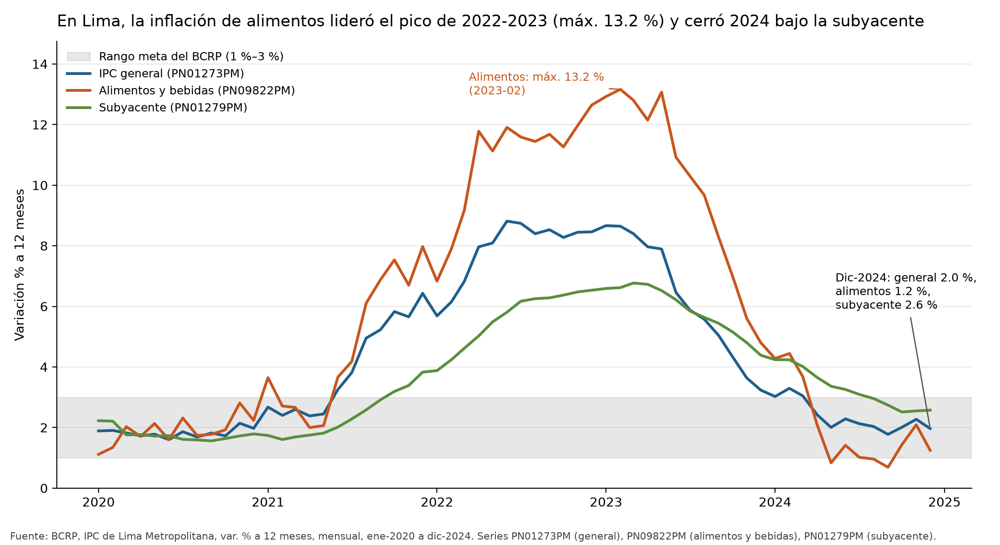
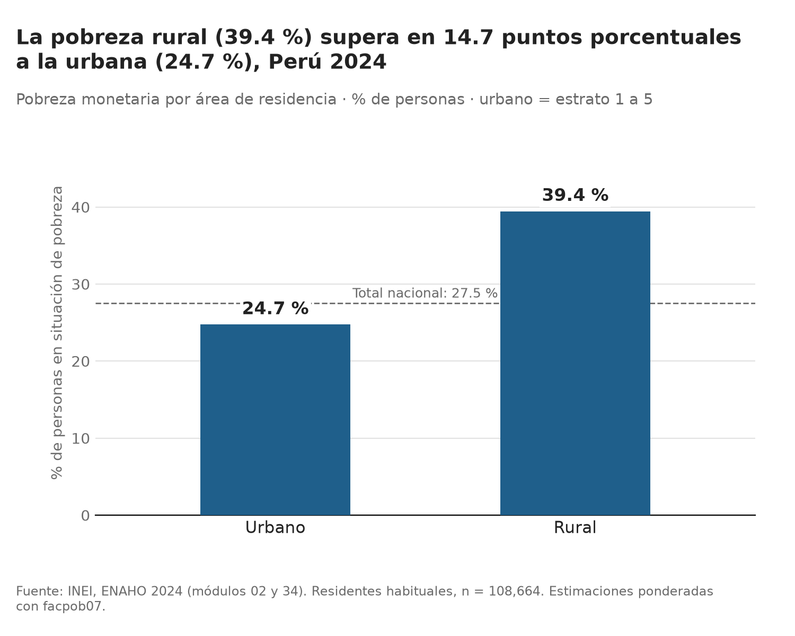
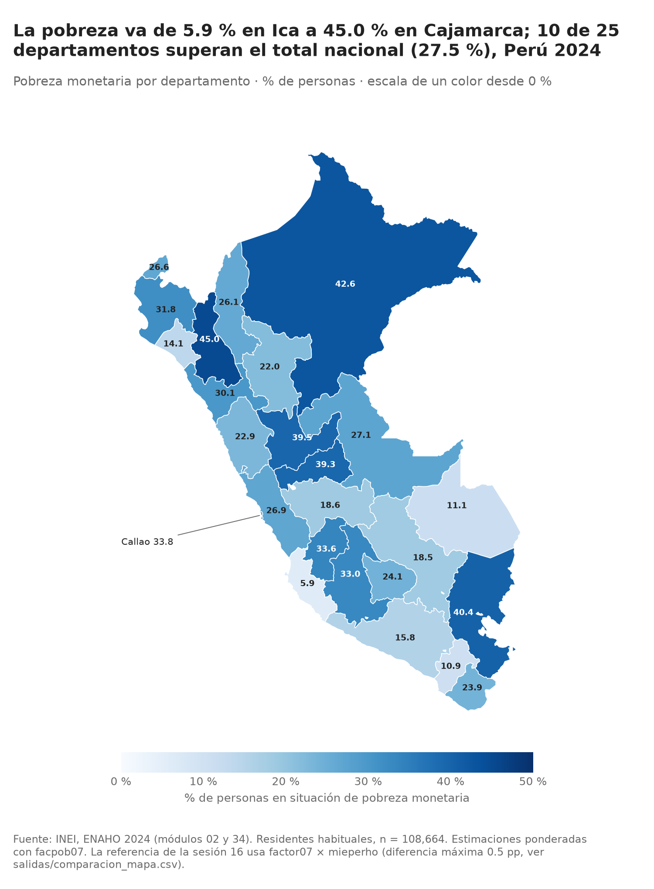

# Inflación en Lima (2020-2024) y pobreza monetaria al cierre del periodo

## 1. Pregunta de investigación

**¿Cómo evolucionó la inflación en Lima entre 2020 y 2024, en particular la de alimentos, y qué diferencias urbanas, rurales y departamentales presentaba la pobreza monetaria al cierre de ese periodo?**

- **Objetivo:** describir el ciclo inflacionario de Lima Metropolitana (BCRP) y, por separado, la pobreza monetaria de 2024 por área y departamento (ENAHO).
- **Delimitación:** la inflación cubre 2020-01 a 2024-12; la pobreza cubre solo 2024. El informe describe y no establece causalidad entre ambas fuentes.

## 2. Fuentes y metodología

| Fuente | Datos | Procesamiento |
|---|---|---|
| BCRP, servidor MCP `bcrp` | PN01273PM (IPC), PN09822PM (alimentos y bebidas), PN01279PM (subyacente); IPC de Lima Metropolitana, var. % a 12 meses, mensual | `buscar_series` para confirmar códigos, `serie` para los datos (descargados con `scripts/descargar_bcrp.py`, que llama a esa herramienta en memoria con `fastmcp.Client` y escribe `salidas/bcrp_inflacion_2020_2024.csv`), `resumen` y `comparar_periodos` como contraste. `scripts/grafico_bcrp.py` lee solo ese CSV y calcula todos los indicadores (`salidas/indicadores_bcrp.csv`), incluida la brecha alimentos − subyacente. |
| INEI, ENAHO 2024 (módulos 34 y 02) | Residentes habituales, n = 108,664 | Skill `limpiando-enaho` (validación en `salidas/validacion.txt`), `graficando-enaho` (barras) y `mapeando-enaho` (mapa). Porcentajes de personas ponderados con `facpob07`. |

Gasto en alimentos (Hallazgo 4): `scripts/gasto_alimentos.py` lee la sumaria 2024 (`sumaria-2024-12g.dta` y `sumaria-2024.dta`) y calcula la participación del gasto en alimentos en el gasto total del hogar (`gashog2d`, gasto total bruto), ponderada con `factor07 × mieperho`. Cifra principal: cociente de totales ponderados, Σ(alimentos·w) / Σ(gashog2d·w). Complemento: promedio ponderado de la participación de cada hogar. Alimentos (definición validada): grupo 1 alimentos dentro del hogar en sus 6 formas (`gru11hd`–`gru16hd`), alimentos fuera del hogar del grupo 11 (`gru111hd`–`gru116hd`) y alimentos preparados ambulantes (`gru111hd2`–`gru116hd2`); sin alcohol, tabaco ni alimentos de mascotas. Como contraste se calcula también la definición de alimentos del do-file oficial del INEI (ver Limitaciones). Pobre = `pobreza ≤ 2`; urbano = `estrato ≤ 5`.

Indicadores: promedio, máximo y mínimo de cada serie, promedio por tramo (2020-2021, 2022-2023, 2024), brecha alimentos − subyacente (pp), pobreza monetaria (% de personas) por área y departamento.

Validación ENAHO (todas las esenciales aprobadas): 108,664 residentes habituales, 25 códigos departamentales, merge m:1 sin duplicados, pobreza nacional 27.53 % (referencia 27.6 %, tolerancia 0.1 pp).

## 3. Resultados

**Hallazgo 1. La inflación de alimentos fue la más alta del ciclo 2022-2023.** El IPC general de Lima alcanzó su máximo en junio de 2022 (8.81 %), mientras que alimentos y bebidas llegó a 13.16 % en febrero de 2023 (PN09822PM). En 2022-2023 el promedio fue 10.42 % en alimentos, 7.09 % en el IPC general y 5.74 % en la subyacente; la brecha alimentos − subyacente promedió 4.67 pp, con un máximo de 6.76 pp en abril de 2022.

**Hallazgo 2. En 2024 la inflación se normalizó y la de alimentos terminó por debajo de la subyacente.** El promedio de 2024 fue 2.35 % en el IPC general, 2.01 % en alimentos y 3.27 % en la subyacente. La brecha alimentos − subyacente promedió −1.25 pp en 2024 (el script la calcula mes a mes con valores sin redondear: −1.2507 pp; restar los promedios ya redondeados, 2.01 − 3.27, daría −1.26 solo por redondeo). En diciembre de 2024 las tasas fueron 1.97 %, 1.25 % y 2.57 %, y la brecha fue −1.33 pp. La inflación de alimentos estuvo por debajo del 1 % en mayo, agosto y septiembre de 2024 (mínimo 0.69 % en septiembre). El IPC general estuvo sobre el 3 % en 34 de los 60 meses del periodo.

**Hallazgo 3. En 2024 la pobreza rural superó a la urbana en 14.7 pp y los departamentos se dispersan entre 5.9 % y 45.0 %.** La pobreza rural fue 39.44 % y la urbana 24.74 % (nacional 27.53 %). Por departamento, Ica tuvo el valor más bajo (5.91 %) y Cajamarca el más alto (44.99 %); 10 de los 25 departamentos superaron el total nacional. Entre los más altos están Loreto (42.61 %), Puno (40.42 %), Huánuco (39.47 %) y Pasco (39.28 %).

**Hallazgo 4. Los alimentos pesan más en el presupuesto de los hogares pobres y rurales.** En 2024, con la definición validada, los alimentos representaron 31.27 % del gasto total de los hogares del país. Por condición de pobreza: 42.05 % en los hogares pobres y 29.27 % en los no pobres. Por área: 29.80 % en la urbana y 43.19 % en la rural. Combinando ambos cortes: 49.85 % en hogares pobres rurales, 40.38 % en pobres urbanos, 40.96 % en no pobres rurales y 28.02 % en no pobres urbanos. El promedio ponderado de la participación de cada hogar da el mismo patrón con niveles algo mayores (36.13 % total; 44.27 % pobres y 33.03 % no pobres; 33.53 % urbano y 47.14 % rural). Con la definición de alimentos del INEI (que incluye más rubros, ver Limitaciones) los niveles suben (41.97 % total; 52.97 % pobres y 39.94 % no pobres; 40.20 % urbano y 56.45 % rural), pero el orden entre grupos es el mismo. Tabla completa: `salidas/gasto_alimentos_2024.csv`. Es una descripción de 2024 y no implica que la composición del gasto explique la pobreza.

**Dato complementario sobre Lima.** Con la ENAHO, la pobreza de Lima Metropolitana (dominio 8) fue 28.03 %; el departamento de Lima registró 26.89 % y el Callao 33.77 % (estimaciones de personas con `facpob07`).

## 4. Visualizaciones

- BCRP: `figuras/inflacion_lima_2020_2024.png`
- ENAHO, urbano vs rural: `figuras/pobreza_urbano_rural_2024.png` (también `pobreza_sexo_2024.png` y `pobreza_departamento_2024.png`)
- Mapa departamental (25 unidades, Lima y Callao separados): `mapas/pobreza_departamento_2024.png`





## 5. Interpretación

- El ciclo 2021-2023 fue una subida generalizada de precios, pero más intensa en alimentos que en el resto de la canasta: la brecha con la subyacente se ensanchó de 1.20 pp (promedio 2020-2021) a 4.67 pp (2022-2023). Hacia 2024 la brecha se invirtió (−1.25 pp en promedio).
- **Lima Metropolitana es el único ámbito donde coinciden las dos fuentes:** el BCRP mide la inflación de Lima Metropolitana (PN01273PM, PN09822PM, PN01279PM) y la ENAHO permite estimar la pobreza de Lima Metropolitana (dominio 8): 28.03 %. Es el único punto donde ambas cifras describen el mismo territorio; para el resto de departamentos, y para el contraste urbano-rural, la inflación de Lima no es una medida de los precios que enfrentan esos hogares.
- **Conexión entre las dos fuentes (descriptiva):** el BCRP muestra que los alimentos fueron el componente más inflacionario del ciclo (máximo 13.16 %; brecha promedio de 4.67 pp sobre la subyacente en 2022-2023), y la ENAHO 2024 muestra que los alimentos ocupan una parte mayor del presupuesto de los hogares pobres (42.05 % del gasto) y rurales (43.19 %) que de los no pobres (29.27 %) y urbanos (29.80 %). Aritméticamente, una misma alza de precios de alimentos recae sobre una porción mayor del gasto de esos hogares. **El informe no demuestra** que esa alza haya aumentado su pobreza: la ENAHO de 2024 es un solo año, no sigue a un mismo hogar en el tiempo, no mide los precios que paga cada hogar y la inflación del BCRP es de Lima Metropolitana, no de las zonas rurales ni de otros departamentos. Es una hipótesis para una investigación con datos de varios años.
- La pobreza de 2024 se concentra fuera de las áreas urbanas: la brecha rural − urbana (14.7 pp) y la dispersión departamental (5.9 % a 45.0 %) muestran que el promedio nacional (27.5 %) oculta situaciones muy distintas.

## 6. Limitaciones

- **Distinta cobertura geográfica:** la inflación del BCRP es de Lima Metropolitana; la pobreza de la ENAHO es nacional, urbana/rural y departamental. No se debe inferir que la inflación de Lima explique la pobreza de otros departamentos.
- **Distinta cobertura temporal:** la ENAHO procesada es solo 2024, así que no hay trayectoria de la pobreza 2020-2024 que contrastar con la inflación. Solo se compara un punto de pobreza con una serie de inflación.
- **Sin causalidad:** todas las diferencias son descriptivas.
- **Ranking departamental no estricto:** el INEI publica la pobreza departamental en grupos con niveles estadísticamente similares, por el error de muestreo. Diferencias pequeñas entre departamentos (por ejemplo, Huánuco 39.5 % y Pasco 39.3 %) no deben leerse como un ranking estricto.
- **Método de ponderación:** las cifras usan `facpob07` sobre residentes habituales. La referencia de la sesión 16 usa la sumaria (`factor07 × mieperho`); las diferencias llegan a 0.52 pp en Puno (16 de 25 departamentos dentro de 0.2 pp). Ver `salidas/validacion.txt`.
- **Gasto en alimentos, qué cubre cada definición.** Los grupos de gasto `gru*` del archivo de 12 grupos no incluyen por sí solos todas las partidas del gasto. La metodología del INEI (`ConstVarGasto`, dentro del zip del módulo 34) construye el gasto de 8 grupos sumando, además de los `gru*`, otras partidas: alimentos consumidos fuera del hogar (`g05hd*`, `ig06hd`), alimentos de instituciones benéficas (`sg23`, `sig24`), de menores fuera del hogar y de ollas comunes (`sg25`–`sig28`), equipamiento (`sg42*`) y otros gastos de transporte y comunicaciones (`g07hd`, `ig08hd`). Con esas partidas la suma reproduce `gashog2d` (diferencia máxima 0.016 soles por hogar). La definición validada de alimentos no incluye `g05hd*`, `ig06hd` ni `sg23`–`sig28`, por lo que **subestima** el gasto en alimentos respecto de la definición del INEI (promedio sin ponderar de 9,442 frente a 12,493 soles por hogar al año). Por eso se reportan ambas; los niveles dependen de la definición, no así el orden entre grupos.
- **Hogares con participación de 0 %:** con la definición validada son 135 de 33,691 hogares (0.40 %; 0.21 % de las personas expandidas), 38 de ellos pobres. En 104 de esos hogares el cero se debe a la definición: registran gasto en alimentos en rubros no incluidos (principalmente comidas fuera del hogar). Los 31 restantes no registran gasto alimentario en ningún componente; no se determinó la causa (no respuesta, bienes libres u otros).
- **Denominador:** `gashog2d` es el gasto total bruto de la medición de pobreza e incluye componentes no monetarios (autoconsumo, pagos en especie, donaciones, alquiler imputado), por lo que la participación es sobre el gasto total y no solo sobre el monetario. La ponderación `factor07 × mieperho` expande personas; el cociente de totales y el promedio por hogar responden a preguntas distintas y por eso difieren.
- **Alcance del gráfico del BCRP:** muestra tasas a 12 meses. Un valor bajo en 2024 no implica que los precios hayan bajado, solo que subieron menos que un año antes.

## 7. Reproducibilidad

| Elemento | Archivo |
|---|---|
| Series BCRP (salida de la herramienta `serie`) | `scripts/descargar_bcrp.py` → `salidas/bcrp_inflacion_2020_2024.csv` |
| Gráfico e indicadores BCRP | `scripts/grafico_bcrp.py` → `figuras/inflacion_lima_2020_2024.png`, `salidas/indicadores_bcrp.csv` |
| Limpieza ENAHO | `.claude/skills/limpiando-enaho/scripts/limpiar.py` → `salidas/personas_2024.parquet`, `salidas/validacion.txt`, `salidas/indicadores.csv` |
| Gráficos ENAHO | `.claude/skills/graficando-enaho/scripts/graficar.py` → `figuras/` |
| Mapa | `.claude/skills/mapeando-enaho/scripts/mapear.py` → `mapas/`, `salidas/comparacion_mapa.csv` |
| Gasto en alimentos (Hallazgo 4) | `scripts/gasto_alimentos.py` → `salidas/gasto_alimentos_2024.csv` |
| Verificación manual | `informes/verificacion.md` |

Comandos (desde `tarea_4/`):

```bash
uv run .claude/skills/limpiando-enaho/scripts/limpiar.py --anio 2024
uv run .claude/skills/graficando-enaho/scripts/graficar.py
uv run .claude/skills/mapeando-enaho/scripts/mapear.py
uv run scripts/descargar_bcrp.py
uv run scripts/grafico_bcrp.py
uv run scripts/gasto_alimentos.py
```

Series: PN01273PM, PN09822PM, PN01279PM (BCRP, API `https://estadisticas.bcrp.gob.pe/estadisticas/series/api/<codigo>/json/2020-1/2024-12`).
